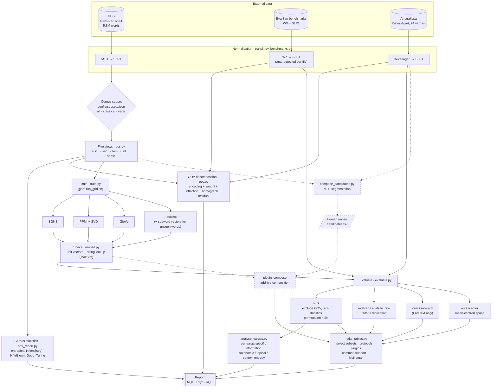

# Pravaala — how the project works

This document explains the project end to end: what each stage does, why, the
mathematics behind it, and where it lives in the code. Every concept is
presented in the same order: **idea** (plain words) → **precisely**
(definitions, statements) → **example** → **code**. Line numbers refer to the
current state of the repository and may drift; function names will not.

Contents
1. [The flow of work](#1-the-flow-of-work)
2. [The question](#2-the-question)
3. [Data](#3-data)
4. [Transliteration](#4-transliteration)
5. [Views: five ways to tokenise one corpus](#5-views-five-ways-to-tokenise-one-corpus)
6. [How much does each view leave unseen? (OOV accounting)](#6-how-much-does-each-view-leave-unseen-oov-accounting)
7. [From co-occurrence to vectors](#7-from-co-occurrence-to-vectors)
8. [Looking up a word that has several lemma IDs](#8-looking-up-a-word-that-has-several-lemma-ids)
9. [Evaluation](#9-evaluation)
10. [The EvalSan-faithful protocol](#10-the-evalsan-faithful-protocol)
11. [Optional: composing vectors for unattested compounds](#11-optional-composing-vectors-for-unattested-compounds)
12. [Running it, and including or excluding components](#12-running-it-and-including-or-excluding-components)
13. [Notation at a glance](#13-notation-at-a-glance)

---

## 1. The flow of work



Dashed nodes are the optional composition plugin. Every arrow into
`make_tables.py` is a separate result file, which is what makes each component
removable without trace (§12).

---

## 2. The question

We train word vectors for Sanskrit from the Digital Corpus of Sanskrit (DCS)
and ask three things:

* **RQ1** — does reducing a word to its lemma, and further to a
  *disambiguated* lemma ID, give better vectors than working with surface
  strings?
* **RQ2** — does the geometry of the vector space recover the Amarakośa's
  classification of words into *vargas* (heaven, water, mankind, …), and
  where does it disagree?
* **RQ3** — how much of the vocabulary problem (words with no vector) is due
  to encoding, sandhi, inflection, homography, and genuine rarity, and what
  does disambiguation buy?

The rest of this document builds the machinery to answer these questions
precisely.

---

## 3. Data

| Source | What it is | Encoding | Used for |
|---|---|---|---|
| DCS (Hellwig) | 5,801,761 annotated words in 770,945 sentences; each word has its surface form, sandhi-resolved form, lemma, lemma ID, and for 9.2 % of words a WordNet-style sense ID | IAST | training corpus |
| EvalSan (Sandhan et al. 2023) | relatedness pairs, synonym MCQs, categorisation, analogies | WX **and** SLP1 (see §4) | evaluation |
| Amarakośa (UoH data, via `aupasana/amara-quiz`) | 11,746 headword entries with varga, synset gloss, gender | Devanāgarī | evaluation (RQ2), source of EvalSan's relatedness/synonym data |

DCS also records a **time slot** for every chapter. Slot 1 is Vedic, slot 2 epic
and early classical (Mahābhārata, Rāmāyaṇa, Caraka, Aṣṭādhyāyī), and slots 3–5
are later classical, Purāṇic, medieval and commentarial. This gives the
corpus subsets `vedic` (1.31M words) and `classical` (4.49M words).

**Code.** `dcs.read_conllu` (`src/pravaala/dcs.py:64`),
`dcs.load_time_slots` (`dcs.py:106`), `benchmarks.load_amarakosa`
(`src/pravaala/benchmarks.py:79`), `config/subsets.json`.

---

## 4. Transliteration

**Idea.** The same Sanskrit word can be written in several ASCII or Unicode
schemes. If the corpus uses one scheme and the benchmark another, a lookup
fails even though the word is there. We convert everything to **SLP1**, where
every phoneme is exactly one ASCII character.

**Precisely.** Let $\Sigma$ be the set of Sanskrit phonemes. A scheme $S$ is an
injective map $\mathrm{enc}_S : \Sigma \to \Gamma_S^{+}$ from phonemes to
non-empty strings over its character set $\Gamma_S$. SLP1 and WX are both
*letter-to-letter* ($|\mathrm{enc}(\sigma)| = 1$), so converting between them
is a fixed relabelling of letters, exactly invertible. IAST is not
letter-to-letter (*kh*, *ai*) and not prefix-free (*a* is a prefix of *ai*),
so we decode it by greedy longest match.

**Example — and a finding.** The Amarakośa word *amṛta* is `amfta` in SLP1 but
`amqwa` in WX. The relabelling is

| phoneme | ṭ | t | ḍ | d | ṇ | ṛ | ṣ | ṅ | ñ |
|---|---|---|---|---|---|---|---|---|---|
| SLP1 | w | t | q | d | R | f | z | N | Y |
| WX | t | w | d | x | N | q | R | f | F |

So the *same letter* means different phonemes: `t` is dental t in SLP1 and
retroflex ṭ in WX. EvalSan's relatedness and synonym files are in WX, while its
other files and its vocabulary are in SLP1. Its README says SLP1 throughout,
and its code never converts. Only **34 %** of the relatedness words contain
none of the letters that differ between the two schemes. Every other word
fails to match, or matches the wrong word.

EvalSan's *trained* vocabularies confirm this. The saved outputs of its
nearest-neighbour notebook (SanskritShala repository) show word2vec and GloVe
neighbours such as `nivizwAni` (niviṣṭāni) and `pArzRiByAm` (pārṣṇibhyām).
These are SLP1 spellings; in WX they would be `niviRtAni` and `pArRNiByAm`.

How we detect the scheme: the letter `z` (ṣ in SLP1) never occurs in WX, and
`x` (dental d in WX, very common) is near-absent in SLP1 (ḷ). The relative
frequencies of `x` and `z` decide.

**Code.** `translit.wx_to_slp1` (`src/pravaala/translit.py:42`),
`iast_to_slp1` (`translit.py:75`), `deva_to_slp1` (`translit.py:120`),
`detect_scheme` (`translit.py:147`); per-file auto-detection in
`benchmarks._converter` (`benchmarks.py:33`). Tests:
`tests/test_translit.py`.

---

## 5. Views: five ways to tokenise one corpus

**Idea.** Between the written text and the abstract "word", Sanskrit adds
three layers of variation: sandhi (sounds merge across word boundaries),
compounding, and inflection. A *view* is a choice of how much of this to
undo. We build five views, each differing from the previous one in exactly
one respect, so that any change in results can be attributed to one step.

| view | token is | removes / adds |
|---|---|---|
| `surf` | the written, sandhied string | — |
| `seg` | the sandhi-resolved inflected word | − sandhi (and compounds split) |
| `lem` | the lemma string | − inflection |
| `lid` | the lemma **ID** | + homographs separated |
| `sense` | the sense ID where annotated, else the lemma ID | + senses separated |

**Example** (DCS, Abhidharmakośa):

```
surf : mohendriyarucitrEDAt tisraH skanDAdideSanAH                      (3 tokens)
seg  : moha indriya ruci trEDAt tisraH skanDa Adi deSanAH                (8 tokens)
lem  : moha indriya ruci trEDa tri skanDa Adi deSanA
lid  : moha_72510 indriya_63664 ruci_71469 trEDa_84461 tri_166282 ...
```

Sandhi glued *moha*, *indriya*, *ruci* and *traidhāt* into one written string.
Inflection turned *tri* into *tisraḥ*. Lemma IDs matter for homographs:
*brahman* is two DCS lemmas, `brahman_149176` (neuter: the sacred word, the
Absolute) and `brahman_149177` (masculine: a priest, the god Brahmā). In
`lem` they are one token; in `lid` they are two. Likewise *agni* carries two
WordNet senses in the `sense` view: the process *fire* and the god *Agni*.

**Precisely.** Let $\mathcal{O}$ be the set of word occurrences in the corpus.
A view is a function $\varphi_k : \mathcal{O} \to \mathcal{V}_k$ assigning each
occurrence a token. Each view *partitions* $\mathcal{O}$: two occurrences are in
the same block iff they get the same token.

Because a lemma ID determines its lemma string,
$\varphi_{\text{lem}} = \operatorname{strip} \circ \varphi_{\text{lid}}$,
every `lid` block lies inside a `lem` block: the `lid` partition is a
*refinement* of the `lem` partition (and `sense` refines `lid`). The same is
**not** true of `seg` and `lem`: one inflected form can belong to two lemmas,
and one lemma has many forms, so neither partition refines the other.

**How much does each step change? Conditional entropy.** Pick an occurrence
$o$ uniformly at random and let $X_k = \varphi_k(o)$. Then

$$H(X_{\text{lid}} \mid X_{\text{lem}})$$

is the average number of bits needed to identify the lemma ID once the lemma
string is known — exactly the homography that `lid` resolves. Since `lid`
determines `lem`, the chain rule gives the clean identity
$H(X_{\text{lid}}) = H(X_{\text{lem}}) + H(X_{\text{lid}} \mid X_{\text{lem}})$.

| quantity | value (all DCS) | reading |
|---|---|---|
| $H(X_{\text{lem}} \mid X_{\text{seg}})$ | 0.100 bits/token | ambiguity of an inflected form between lemmas |
| $H(X_{\text{lid}} \mid X_{\text{lem}})$ | 0.115 bits/token | homography resolved by lemma IDs |
| $H(X_{\text{seg}} \mid X_{\text{lem}})$ | 2.40 bits/token | inflectional information discarded by lemmatising |

The last row is the price of lemmatisation: an average of 2.4 bits per word
(case, number, person, tense) are thrown away. The first two are what
disambiguation recovers.

**Sparsity, model-free: Good–Turing.** If $N$ tokens have been seen and $N_1$
types occurred exactly once, then $N_1/N$ estimates the probability that the
*next* token is a type never seen before (Good 1953). It falls from 0.162
(`surf`) to 0.024 (`seg`) to 0.0065 (`lem`): undoing sandhi removes most of
the sparsity, and lemmatising removes most of what is left.

**Code.** `dcs.view` (`dcs.py:142`), `dcs.strip_id` (`dcs.py:161`);
`scripts/build_corpora.py` writes `data/corpora/<subset>/<view>.txt`;
`infotheory.conditional_entropy` (`src/pravaala/infotheory.py:45`),
`good_turing_unseen` (`infotheory.py:75`); numbers produced by
`scripts/oov_report.py` (ambiguity block at line 37).

---

## 6. How much does each view leave unseen? (OOV accounting)

**Idea.** A benchmark word is *out of vocabulary* (OOV) if the model has no
vector for it. We want to know *why* each OOV word is missing. We change one
thing at a time (encoding, then sandhi, then inflection, then homograph
splitting) and record how the OOV rate moves at each step.

**Precisely.** Fix a set $\mathcal{B}$ of benchmark words and a frequency
threshold $\tau$ (a word needs at least $\tau$ occurrences to get a vector).
For view $k$, let $\mathcal{V}_k(\tau)$ be the types with count $\ge \tau$, and

$$\mathrm{OOV}_k = \frac{|\mathcal{B} \setminus \mathcal{V}_k(\tau)|}{|\mathcal{B}|}.$$

For the ID views a string counts as present if *some* ID realising it has
count $\ge \tau$. Writing the naive rate (benchmark in its original encoding,
surface tokens) as a sum of consecutive differences:

$$
\mathrm{OOV}^{\text{raw}}_{\text{surf}}
= \underbrace{(\mathrm{OOV}^{\text{raw}}_{\text{surf}} - \mathrm{OOV}_{\text{surf}})}_{\text{encoding}}
+ \underbrace{(\mathrm{OOV}_{\text{surf}} - \mathrm{OOV}_{\text{seg}})}_{\text{sandhi}}
+ \underbrace{(\mathrm{OOV}_{\text{seg}} - \mathrm{OOV}_{\text{lem}})}_{\text{inflection}}
+ \underbrace{(\mathrm{OOV}_{\text{lem}} - \mathrm{OOV}_{\text{lid}})}_{\text{homograph split}}
+ \underbrace{\mathrm{OOV}_{\text{lid}}}_{\text{residual}}
$$

The sum *telescopes*: it is an identity, not an approximation. Such
decompositions generally depend on the order of the steps; here the order is
forced, because lemmas only exist for segmented text.

**A small guaranteed fact.** The homograph-split term is never positive.
Splitting a lemma into IDs divides its count among them, and the largest piece
is at most the whole:
$\max_{t} \#(t) \le \sum_{t} \#(t) = \#(\text{lemma string})$.
So `lid` can push a word below the threshold but never above it.

**Result** (relatedness test words, $\tau = 5$):

| naive | encoding | sandhi | inflection | homograph | rare | absent |
|---|---|---|---|---|---|---|
| 89.7 % | 14.1 | 30.0 | 10.5 | −0.8 | 19.2 | 16.8 |

The residual itself splits into *rare* (seen, but fewer than $\tau$ times) and
*absent* (never seen). About half of the absent Amarakośa words are compounds
or participles. DCS analyses these into members or roots, so they never appear
as lemmas at all (§11).

**Code.** `oov.decompose` (`src/pravaala/oov.py:50`), `oov.string_counts`
(`oov.py:30`), driver `scripts/oov_report.py:52`.

---

## 7. From co-occurrence to vectors

### 7.1 Counting contexts

**Idea.** "You shall know a word by the company it keeps" (Firth). For each
word we count which words appear near it.

**Precisely.** With vocabulary size $n$ and window $L$, the co-occurrence
matrix $C \in \mathbb{R}^{n \times n}$ has $C_{wc}$ = the weighted number of
times $c$ occurs within $L$ positions of $w$ in the same sentence. A pair at
distance $d$ contributes $1/d$ (harmonic weighting, as in GloVe), so nearer
words count more.

**Code.** `embed.cooccurrence` (`src/pravaala/embed.py:35`).

### 7.2 Pointwise mutual information: discounting frequent words

**Idea.** Raw counts are dominated by frequent words: *ca* ("and") co-occurs
with everything. What matters is whether $c$ appears near $w$ *more often than
chance*. PMI measures exactly that.

**Precisely.**

$$\mathrm{PMI}(w,c) = \log \frac{P(w,c)}{P(w)\,P(c)}.$$

It is 0 when $w$ and $c$ are independent, positive when they attract, and
negative when they repel. Negative estimates are unreliable (they mostly
reflect unseen pairs), so we keep the positive part (PPMI).

Why this is the right sense of "reduce the effect of high-frequency words":
averaging a word's PMI over its own contexts gives a familiar quantity,

$$\sum_c P(c \mid w)\,\mathrm{PMI}(w,c) = \sum_c P(c \mid w) \log\frac{P(c \mid w)}{P(c)} = D_{\mathrm{KL}}\big(P(\cdot \mid w)\,\big\|\,P(\cdot)\big),$$

the KL divergence of $w$'s context distribution from the background
distribution. A particle like *ca* appears in all contexts in roughly
background proportions: its divergence is small, so its PMI row is small. A
content word like *jala* ("water") has a distinctive context profile and a
large divergence. PMI therefore weights a word by how *informative* its
company is, not by how often it occurs.

**Two standard refinements** (Levy, Goldberg & Dagan 2015):

* *Context smoothing:* replace $P(c)$ by $P_\alpha(c) \propto \#(c)^{\alpha}$
  with $\alpha = 0.75$. This slightly inflates the probability of rare
  contexts and tames the extreme PMI values that rare pairs otherwise get.
* *Shift:* subtract $\log k$ (see 7.4 for why).

**Tiny example.** Suppose 1,000 pairs, $w$ occurs in 10, $c$ in 100, and they
co-occur 5 times. Then $\mathrm{PMI} = \log_2 \frac{5/1000}{(10/1000)(100/1000)} = \log_2 5 \approx 2.3$ bits.
If $c$ were *ca*, occurring in 500 pairs, the same 5 co-occurrences would give
$\log_2 1 = 0$.

**Code.** `infotheory.ppmi_matrix` (`infotheory.py:88`); test
`test_ppmi_independent_is_zero` checks that an independent (rank-one) count
matrix yields PMI = 0 everywhere.

### 7.3 Low-rank factorisation (PPMI + SVD)

**Idea.** The PPMI matrix is huge and noisy. Compressing it to $d$ dimensions
keeps the dominant patterns and averages away the noise.

**Precisely.** Write $M = \mathrm{PPMI}$ and its singular value decomposition
$M = U \Sigma V^\top$. Keeping the top $d$ singular values gives
$M_d = U_d \Sigma_d V_d^\top$. By the **Eckart–Young–Mirsky theorem**, $M_d$
is the closest rank-$d$ matrix to $M$ in Frobenius norm. Word vectors are the
rows of $U_d \Sigma_d^{p}$; we use $p = 0.5$, which Levy et al. found works
better than the "natural" $p = 1$.

**Code.** `embed.svd_embeddings` (`embed.py:69`).

### 7.4 SGNS (word2vec) is factorising the same matrix

**Idea.** word2vec looks very different (a neural objective trained by SGD),
but it targets the same object.

**Theorem (Levy & Goldberg 2014).** Skip-gram with $k$ negative samples, at
its optimum (with enough dimensions), satisfies
$\mathbf{w}^\top \mathbf{c} = \mathrm{PMI}(w,c) - \log k$.

So SGNS and PPMI+SVD are two *estimators* of a low-rank approximation of the
same shifted-PMI matrix. A difference between them in our results is a
difference of estimation (weighting, optimisation), not of what is being
estimated. This is what licenses comparing them at all.

**Subsampling, rewritten in bits.** word2vec randomly drops occurrences of
frequent words, keeping each with probability $\kappa(w) = \min\big(1, \sqrt{t/f(w)}\big)$,
where $f(w)$ is the word's relative frequency. With the self-information
$I(w) = -\log_2 f(w)$ (how surprising the word is) and $I_t = -\log_2 t$:

$$\kappa(w) = \min\big(1,\; 2^{-(I_t - I(w))/2}\big).$$

Read it as: *a word carrying fewer than $I_t$ bits is down-sampled, at a rate
exponential in how many bits it falls short.* With $t = 10^{-4}$,
$I_t \approx 13.3$ bits; *ca* carries about 5 bits and is kept only about
6 % of the time.

**Code.** `embed.train_sgns` (`embed.py:78`, gensim);
`infotheory.surprisal_keep_prob` (`infotheory.py:115`); test
`test_subsampling_matches_word2vec`.

### 7.5 GloVe: a weighted PMI factorisation

**Precisely.** GloVe minimises

$$J = \sum_{i,j:\,X_{ij}>0} f(X_{ij})\,\big(\mathbf{w}_i^\top \mathbf{u}_j + b_i + c_j - \ln X_{ij}\big)^2, \qquad f(x) = \min\big(1, (x/x_{\max})^{3/4}\big).$$

If the biases absorb the log-marginals ($b_i = \ln X_{i\cdot}$,
$c_j = \ln X_{\cdot j} - \ln N$), a perfect fit means
$\mathbf{w}_i^\top \mathbf{u}_j = \mathrm{PMI}(i,j)$. GloVe is therefore
another factorisation of PMI, by *weighted* least squares, with $f$
down-weighting rare and noisy cells. Final vectors are $W + U$.

**Code.** `glove.train_glove_reference` (`src/pravaala/glove.py`) runs the
reference implementation (github.com/stanfordnlp/GloVe) on the same corpus file
and window: symmetric window with $1/d$ weighting, as in 7.1; 50 iterations;
$x_{\max}=10$, as in the reference demo for small corpora (the paper's 100 was
set for billions of tokens); vectors $W+U$. Our own AdaGrad implementation,
used earlier, stayed near chance ($\rho\approx0.03$) and was replaced.

### 7.6 FastText: vectors for unseen strings

FastText is SGNS in which a word's vector is the sum of vectors for its
character n-grams. It can therefore build a vector for a word it never saw,
which is directly relevant to RQ3. At training time we precompute such
vectors for every benchmark word FastText didn't see and store them
separately, so evaluation can switch them on (`ours+subword`) or off.

**Code.** `embed.train_sgns(..., fasttext=True)`; subword block in
`scripts/train.py` (inside the `if a.model in ("sgns", "fasttext")` branch,
line 39).

**All four models in one picture:** each one estimates a low-rank
approximation of (a variant of) the PMI matrix. They differ in the loss
(implicit / squared / weighted squared), the weighting of cells, and the
parametrisation (words / sub-word units).

---

## 8. Looking up a word that has several lemma IDs

**Idea.** Benchmarks give *strings* (*brahman*). In the `lid` view that string
names two vectors. How similar are two such strings?

**Precisely.** Let $T(s)$ be the set of types realising string $s$. The
*MaxSim* similarity (Reisinger & Mooney 2010) is

$$\mathrm{sim}(s,s') = \max_{t \in T(s),\; t' \in T(s')} \cos(\mathbf{t}, \mathbf{t}').$$

Two words are similar if *some* reading of one is similar to *some* reading of
the other, which is how a human judges "is *brahman* related to *veda*?".
Where a single vector is needed (clustering), we use the most frequent ID, or
optionally the count-weighted mean.

**Code.** `embed.Space` (`embed.py:90`); `Space.sim` (`embed.py:135`),
`Space.vec` (`embed.py:128`). All vectors are normalised to unit length at
construction, so a dot product is a cosine.

---

## 9. Evaluation

### 9.1 Tasks

| task | gold | our score |
|---|---|---|
| Relatedness (EvalSan, from Amarakośa) | pair label $y \in \{0,1,2\}$: unrelated / same varga / same synset | Spearman $\rho$, AUCs, 3-way macro-F1 |
| Synonym MCQ | 1 correct of 4 options | accuracy with 95 % interval |
| Categorisation (EvalSan) | category per word | purity, NMI, VI + permutation null |
| Varga recovery (RQ2) | varga per Amarakośa word | purity, NMI, VI + permutation null |

### 9.2 Coverage, never imputation

**Idea.** If a word has no vector, we leave the item out and report what
fraction we kept (coverage). EvalSan instead substitutes the average vector.
Two missing words then get *identical* vectors, cosine 1, and are labelled
"same synset". That fabricates evidence.

**Common support.** Coverage is not neutral: a model that only covers frequent
words is scored on an easier set. So when we compare models, we score all of
them on the **intersection** of the items they all cover, and use paired
tests (McNemar for the MCQ) on that set.

**Code.** `evaluate.relatedness` (`src/pravaala/evaluate.py:47`),
`evaluate.synonym_mcq` (`evaluate.py:76`); common support in
`scripts/make_tables.py` (`--common_support`).

### 9.3 Why rank statistics

**Idea.** Different models produce cosines on different scales. In our GloVe
vectors, two random words already have cosine ≈ 0.84 (strong anisotropy). A
fixed threshold like "cosine > 0.5 means related" is therefore meaningless
across models. *Rankings* are comparable.

**Precisely.** Spearman $\rho$ and AUC depend on the similarity scores only
through their ranks. So they are unchanged by any strictly increasing
transformation of the scale. The AUC between label groups $i$ and $j$,

$$\mathrm{AUC}_{ij} = \Pr\big(s(X_i) > s(X_j)\big) + \tfrac12 \Pr\big(s(X_i) = s(X_j)\big),$$

is the probability that a random same-synset pair scores higher than a random
unrelated pair. It equals the Mann–Whitney $U$ statistic divided by
$|X_i|\,|X_j|$. 0.5 is chance and 1 is perfect.

For the 3-way classification, the two thresholds are chosen on the **dev**
split (grid search, macro-F1) and applied unchanged to test.

**Code.** `evaluate.auc` (`evaluate.py:35`), `tune_thresholds`
(`evaluate.py:59`), used at `scripts/evaluate.py:64`.

**Anisotropy and centring.** All vectors share a common component (a mean
direction), so cosines are inflated. The protocol `ours+center` subtracts the
mean vector before evaluating (Mu & Viswanath 2018, without removing further
principal components). It is a separate protocol with its own result files,
so it can be reported or dropped independently. Mean pairwise cosine on
`lem`: PPMI-SVD 0.10, SGNS 0.26, FastText 0.33, GloVe 0.84; centring raises
SGNS relatedness from ρ = 0.38 to 0.50 and leaves PPMI-SVD unchanged.

### 9.4 Comparing two partitions: purity, NMI, VI

We cluster word vectors into $k$ groups and compare with the gold classes. Let
$K$ be the cluster and $G$ the gold class of a random word.

* **Purity** — label each cluster with its majority class and count the
  fraction of words labelled correctly: $\mathrm{pur} = \sum_k \max_g P(K{=}k, G{=}g)$.
  *Problem:* splitting a cluster can never lower purity. The max of a sum is
  at most the sum of the maxes. In the extreme, every word in its own cluster
  has purity 1. Purity cannot compare clusterings with different $k$
  (tested in `test_purity_monotone_under_refinement`).
* **NMI** — $2\,I(K;G)/(H(K)+H(G))$: how many bits knowing the cluster tells
  you about the class, normalised to $[0,1]$.
* **VI** (variation of information, Meilă 2007) — $H(K \mid G) + H(G \mid K)$:
  the bits you are missing about each partition given the other. VI is a true
  **metric** on partitions (zero iff equal, symmetric, triangle inequality;
  tested in `test_vi_metric_axioms`). Lower is better.

**Permutation null.** Even random clusters have non-zero purity, more so when
classes are unequal in size. We shuffle the gold labels 200 times, keeping
the clusters fixed, and report the null mean and an empirical $p$-value. A
score is only interesting relative to its null.

**Clustering methods.** *k*-means on unit vectors approximates spherical
*k*-means, because $\|\mathbf{x}-\boldsymbol{\mu}\|^2 = 2 - 2\cos(\mathbf{x},\boldsymbol{\mu})$
for unit vectors. Ward agglomerative clustering on unit vectors uses the same
geometry. Average-linkage clustering degenerates into one giant cluster here
(chaining), so it is not used.

**Gold is a relation, not a function.** An Amarakośa word can belong to
several vargas (polysemy, especially in the *nānārtha-varga*). For clustering
we keep words with exactly one varga, excluding the *nānārtha* and *avyaya*
vargas. The polysemous remainder is precisely the material for RQ3.

**Code.** `evaluate.purity` (`evaluate.py:85`), `cluster_scores`
(`evaluate.py:95`); `infotheory.nmi` (`infotheory.py:57`),
`variation_of_information` (`infotheory.py:63`); exclusions at
`scripts/evaluate.py:37`.

### 9.5 Which vargas are recovered? (per-varga analysis, RQ2)

**Idea.** NMI says how well the clustering matches the vargas *overall*. For
RQ2 we also want to know *which* vargas are recovered and what they have in
common.

**A size trap.** The obvious per-class score is best-match F1: the best
F-measure between the varga and any single cluster. But F1 is strongly
size-biased. With 22 clusters of ~160 words each, a 6-word varga cannot reach
a high F1 against any cluster. In our data $\rho(\text{F1}, n_g) = 0.81$, and
even after subtracting a permutation null the "lift" still correlates 0.64
with size.

**The information-theoretic fix: specific information.** Mutual information
splits exactly over the gold classes:

$$I(K;G) = \sum_g P(g)\, i_g, \qquad i_g = H(K) - H(K \mid G = g).$$

$i_g$ is the *specific information* of varga $g$ (DeWeese & Meister 1999):
how many bits knowing that a word is in varga $g$ removes from your
uncertainty about its cluster. If the varga's words all sit in one cluster,
$H(K \mid G=g) = 0$ and $i_g$ is maximal. If they are spread like random words,
$i_g \approx 0$.

The plug-in estimate of $H(K \mid G=g)$ is biased *downwards* for small
samples: 6 random words cannot spread over 22 clusters, so a small varga
looks concentrated by accident. We therefore subtract what the same number of
*random* words would give:

$$\hat\imath_g = \mathbb{E}_\pi\big[\hat H(K \mid G^\pi = g)\big] - \hat H(K \mid G = g),$$

where $G^\pi$ shuffles the gold labels (200 shuffles). The bias appears in both
terms and cancels. Its correlation with varga size drops to −0.14.

**Explanatory variables tested per varga** (all computed on the same words):

| variable | what it measures | why it might matter |
|---|---|---|
| group (config) | concrete / abstract / cosmological | the proposal's concrete-vs-abstract hypothesis |
| $H(\text{category} \mid G=g)$ | spread of the varga's words over the Amarakośa's own ontological categories (Miller–Madow corrected) | internally heterogeneous vargas should scatter |
| residual $H(\text{text} \mid W=w)$ | spread of a word over DCS texts, after regressing out log-frequency | topically concentrated words (*prakaraṇa*) should cluster |
| residual $H(C \mid W=w)$ | context entropy, frequency-controlled | unselective words should scatter |

Both entropies are regressed on $\log_2$ frequency first, because plug-in
entropy grows with sample size: a frequent word *looks* less concentrated
just by being seen more often.

**Power.** There are only 22 vargas, so a Spearman correlation needs
$|\rho| > 0.42$ to reach $p < 0.05$. Negative results at this level mean
"not detectable with 22 units", not "no effect".

**Code.** `scripts/analyse_vargas.py`; grouping in
`config/varga_groups.json` (provisional, editable).

### 9.6 Uncertainty

MCQ accuracies carry Wilson score intervals, which behave well for small $n$
and accuracies near 0 or 1 (`evaluate.wilson`, `evaluate.py:25`). Model
comparisons on common support use exact McNemar tests: only items where the
two models *disagree* are informative, and under the null each disagreement
is a fair coin.

---

## 10. The EvalSan-faithful protocol

To compare with published numbers we also replicate EvalSan's own evaluation,
task by task. Its behaviour differs from ours in four ways:

1. relatedness and categorisation **impute the mean vector** for OOV words;
2. the synonym MCQ instead **skips** items with an OOV word;
3. relatedness uses **fixed thresholds** (0.25, 0.5), not tuned on dev;
4. categorisation reports the **best purity of six clustering setups**, chosen
   on the test set, which inflates the score.

`evalsan` runs this protocol on transliteration-normalised benchmarks;
`evalsan_raw` keeps the original WX words, reproducing the encoding mismatch
exactly. The difference between the two isolates the effect of §4.

**Code.** `src/pravaala/evalsan_compat.py` (self-contained; nothing else
imports it).

---

## 11. Optional: composing vectors for unattested compounds

**Idea.** Many Amarakośa synonyms are compounds (*jalaprāya*, *vīrapatnī*)
that DCS splits into members, so the whole compound never gets a vector. We
can (a) guess the split, (b) let a human check it, and (c) build a vector
from the members.

**Segmentation by minimum description length.** Using lemma frequencies
$p(m) = \#(m)/N$, choose the split $s = (m_1, \dots, m_r)$ that minimises
the total surprisal

$$L(s) = \sum_{i=1}^{r} -\log_2 p(m_i) \quad\text{bits}.$$

Every extra member costs bits, so splitting into many tiny pieces is penalised
automatically. Junction sandhi (*padma + ākara → padmākara*) and stem
alternations (*rājan → rāja-*) are undone at each candidate split point.

**Confidence in bits.** Let $\Delta = L(s_2) - L(s_1)$ be the margin of the best
split over the runner-up. With equal prior belief in all splits, the
posterior odds of the best over the second-best are exactly $2^{\Delta}$. A
margin of 4 bits means 16 : 1.

**Why a human is in the loop.** Low surprisal is not etymology: *akṣīva*
("drunk") splits beautifully, but wrongly, as *akṣi + iva* ("like an eye").
So the plugin uses **only rows a human marked `approved`**. The `auto` status
is a sorting hint (high margin, no warning flags), not an acceptance.

**Composition.** $\mathbf{v}(w) = \sum_i \mathbf{v}(m_i) \,/\, \|\sum_i \mathbf{v}(m_i)\|$
(additive, Mitchell & Lapata 2010). This ignores word order, so it cannot
tell a *tatpuruṣa* (*rāja-puruṣa*, "king's man") from a *dvandva*. Treat its
results as a lower bound.

**Code.** `src/pravaala/plugins/compose.py`: `Segmenter.kbest` (line 85),
`candidates` (line 106), `augment` (line 150);
`scripts/compose_candidates.py`; evaluated by
`scripts/evaluate.py --plugins compose` (line 126).

---

## 12. Running it, and including or excluding components

```bash
for s in all classical vedic; do python scripts/build_corpora.py $DCS data/corpora --subset $s; done
python scripts/oov_report.py data/corpora/all $E $A
scripts/run_grid.sh $E $A all 100 2          # 4 models x 3 views, all protocols
python scripts/make_tables.py --subsets all --protocols ours evalsan --common_support --evalsan $E
```

Every subset, protocol and plugin writes to its **own** files:

```
data/corpora/<subset>/<view>.txt
results/<subset>/<model>_<view>_d.._s<seed>/
    vectors.npz              config.json
    eval_<protocol>.json     items_<protocol>.json      (one pair per protocol / plugin)
```

`make_tables.py` reads only what you select (`--subsets`, `--protocols`,
`--plugins`, `--models`, `--views`). Leaving a component out of the selection
removes it from every generated table: nothing downstream depends on it.

---

## 13. Notation at a glance

| symbol | meaning |
|---|---|
| $\mathcal{O}$ | set of word occurrences in the (sub)corpus |
| $\varphi_k$, $X_k$ | view $k$; the token of a random occurrence under view $k$ |
| $\mathcal{V}_k(\tau)$ | types of view $k$ with count $\ge \tau$ |
| $\mathcal{B}$ | benchmark word set |
| $\#(\cdot)$ | count |
| $C$ | co-occurrence matrix; $M$ its (shifted, positive) PMI transform |
| $H, I, D_{\mathrm{KL}}$ | entropy, mutual information, KL divergence (bits) |
| $\mathrm{PMI}_\alpha$ | PMI with context distribution smoothed by exponent $\alpha$ |
| $U_d \Sigma_d^{p}$ | truncated-SVD word vectors |
| $T(s)$ | types (lemma IDs) realising string $s$ |
| $K, G$ | cluster label and gold label of a random evaluated word |
| $\mathrm{pur}, \mathrm{NMI}, \mathrm{VI}$ | purity, normalised MI, variation of information |
| $i_g$, $\hat\imath_g$ | specific information of varga $g$; its bias-corrected estimate |
| $L(s)$, $\Delta$ | description length of a segmentation; margin in bits |

### References
DeWeese & Meister (1999) *How to measure the information gained from one
symbol*; Eckart & Young (1936); Firth (1957); Good (1953); Harris (1954);
Levy & Goldberg (2014) *Neural word embedding as implicit matrix
factorization*; Levy, Goldberg & Dagan (2015) *Improving distributional
similarity with lessons learned from word embeddings*; Meilă (2007)
*Comparing clusterings — an information based distance*; Mikolov et al.
(2013); Miller (1955) *Note on the bias of information estimates*; Mitchell & Lapata (2010); Pennington, Socher & Manning (2014);
Bojanowski et al. (2017); Reisinger & Mooney (2010); Sandhan et al. (2023)
*Evaluating neural word embeddings for Sanskrit*; Hellwig (2010–) DCS.
